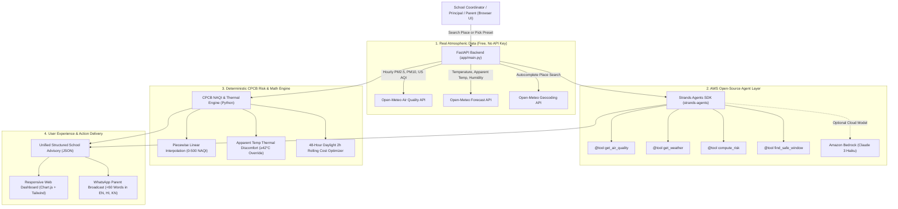

# ShwaasShala (श्वासशाला) — Pediatric Air Safety & Outdoor Window Advisor for Indian Schools

> **Environmental Hacks (WeMakeDevs x AWS) — Track 01: Air**  
> *An intelligent pediatric environmental health agent powered by the AWS Open-Source Strands Agents SDK that tells Indian schools and parents every morning whether it is safe for children to be outside, and exactly when.*

[](https://python.org)
[](https://github.com/strands-agents/sdk-python)
[](https://fastapi.tiangolo.com)
[](https://www.docker.com/)
[](LICENSE)

---

## 📌 Table of Contents
1. [The Real-World Problem](#-the-real-world-problem)
2. [What is ShwaasShala?](#-what-is-shwaasshala)
3. [Core Features](#-core-features)
4. [System Architecture](#-system-architecture)
5. [AWS & Open-Source Tooling](#-aws--open-source-tooling)
6. [CPCB India NAQI & Health Risk Matrix](#-cpcb-india-naqi--health-risk-matrix)
7. [Installation & Setup](#-installation--setup)
8. [Usage Guide](#-usage-guide)
   - [Interactive Web Dashboard](#1-interactive-web-dashboard)
   - [Parent WhatsApp Broadcasts](#2-parent-whatsapp-broadcasts-under-60-words)
   - [REST API Endpoints & Examples](#3-rest-api-endpoints--curl-examples)
9. [Configuration & Environment Variables](#-configuration--environment-variables)
10. [Automated Testing](#-automated-testing)
11. [Deployment on AWS (App Runner & Lightsail)](#-deployment-on-aws)
12. [Project Structure](#-project-structure)
13. [Limitations & Roadmap](#-limitations--roadmap)

---

## 🚨 The Real-World Problem

Over **millions of school children in India** breathe air that breaches WHO and Central Pollution Control Board (CPCB) safety standards daily. During winter ground-level temperature inversions and crop residue burning across Northern and Central India, fine particulate matter ($PM_{2.5}$) routinely surges past 150 to 350+ $\mu\text{g/m}^3$.

Despite this daily public health emergency, school administration fails in two distinct ways:

1. **Delayed, Abstract City-Wide Averages**: Principals receive city-wide headline numbers hours after the school day begins. Weather apps display abstract figures (e.g., "168 $\mu\text{g/m}^3$") that provide zero actionable operational guidance to a non-technical school coordinator.
2. **Binary Panic vs. Lethal Routine**: Schools either shut down entirely in panic, or line students up in dense smog at **7:30 AM to 8:30 AM** for a 45-minute outdoor morning assembly and vigorous endurance sports drills. This happens often during peak inversion, triggering pediatric respiratory distress and asthma attacks.

---

## 💡 What is ShwaasShala?

**ShwaasShala (श्वासशाला)** translates to *"Breathing School"*. It is an open-source, production-ready AI agent that gives school coordinators, physical education (PE) teachers, and parents a definitive daily answer:

1. **Unambiguous Morning Verdict**: An instant **GREEN / AMBER / RED** safety badge tailored for school environments.
2. **The "Safest 2-Hour Window"**: Instead of telling schools "don't go outside all day," it computes the optimal 2-hour continuous daylight window in the next 48 hours when boundary-layer air mixing lowers pollution and thermal heat index.
3. **Actionable School Directives**: Concrete directives for morning assembly, sports (PE), lunch recess, school commute, and asthmatic children.
4. **Culturally Nuanced WhatsApp Broadcasts**: Formatted broadcasts strictly under 60 words in **English, Hindi (हिंदी), and Kannada (ಕನ್ನಡ)** with one-click clipboard copy and direct `wa.me` sharing.
5. **Built-in fallback: if the model is unavailable, the rule-based engine still returns an advisory.**

---

## ⚡ Core Features

- 🌐 **No API Keys Required for Atmospheric Data**: Pulls live, free, no API key $PM_{2.5}$, $PM_{10}$, US AQI, temperature, and apparent heat index from Open-Meteo.
- 📍 **One-Click Presets & Pan-India Search**: Pre-configured with 8 major hubs (*Delhi, Mumbai, Bengaluru, Hubballi-Dharwad, Kolkata, Lucknow, Pune, Hyderabad*) plus real-time autocomplete geocoding for any Indian school or locality.
- 🧮 **Deterministic CPCB Risk Engine**: Official Central Pollution Control Board (CPCB) NAQI piecewise linear interpolation combined with a conservative heat-stress threshold heuristic.
- 🤖 **AWS Strands Agents SDK Integration**: Equips an intelligent agent with modular `@tool` decorators (`get_air_quality`, `get_weather`, `compute_risk`, `find_safe_window`).
- 🛡️ **Built-in fallback: if the model is unavailable, the rule-based engine still returns an advisory.** Automatically displays `⚡ AI-generated (Strands Agent)` when cloud LLMs are active, and falls back seamlessly to `🛡️ Rule-based Fallback (Deterministic Engine)` if cloud keys are absent or throttled.
- 📱 **Mobile-First Non-Technical UI**: Clean typography, Tailwind CSS, responsive Chart.js visualizer highlighting the safest window in gold, and direct WhatsApp sharing.

---

## 🏗️ System Architecture



---

## ☁️ AWS & Open-Source Tooling

ShwaasShala is built specifically for the **WeMakeDevs x AWS Environmental Hackathon (Track 01: Air)**:

- **AWS Open-Source Tool**: **[Strands Agents SDK (`strands-agents`)](https://github.com/strands-agents/sdk-python)**  
  The agent framework orchestrates tool invocation (`@tool`), enforces structured Pydantic schema validation, and connects directly to Amazon Bedrock.
- **Amazon Bedrock Connector**: Native integration with `BedrockModel` supporting `anthropic.claude-3-haiku-20240307-v1:0` for intelligent synthesis.
- **Without Bedrock credentials the app runs on the deterministic engine; with credentials the Strands agent writes the advisory.**
- **Cloud Deployment Scripts**: Ready-to-run automated bash scripts for **AWS App Runner** and **AWS Lightsail Containers** in `deploy/`.

---

## 📊 CPCB India NAQI & Health Risk Matrix

ShwaasShala deterministically converts raw $PM_{2.5}$ readings ($\mu\text{g/m}^3$) into the official Indian Central Pollution Control Board (CPCB) National Air Quality Index (NAQI):

| $PM_{2.5}$ Range ($\mu\text{g/m}^3$) | CPCB Band | CPCB NAQI | Risk Level | Primary Action for Schools |
| :---: | :---: | :---: | :---: | :--- |
| **0.0 – 30.0** | **Good** | 0 – 50 | **GREEN** | Full outdoor morning assembly and sports permitted. |
| **31.0 – 60.0** | **Satisfactory** | 51 – 100 | **GREEN** | Normal outdoor activities safe for healthy children. |
| **61.0 – 90.0** | **Moderate** | 101 – 200 | **AMBER** | Limit strenuous endurance sports; sensitive kids stay indoors. |
| **91.0 – 120.0** | **Poor** | 201 – 300 | **RED** | Cancel outdoor morning assembly; move PE classes indoors. |
| **121.0 – 250.0** | **Very Poor** | 301 – 400 | **RED** | Mandatory indoor lunch & recess; windows shut; N95 commute. |
| **250.0+** | **Severe** | 401 – 500 | **RED** | Emergency: Suspend outdoor exposure; air-purified spaces only. |

> **Thermal Override**: If the apparent temperature (heat index) exceeds **$42^\circ\text{C}$**, the risk level automatically escalates to **RED** regardless of air quality to protect children against acute heat exhaustion.

---

## 🚀 Installation & Setup

### Prerequisites
- Python 3.11 or 3.12 installed
- Git installed
- *(Optional)* Docker installed

### Quickstart in 3 Commands

```bash
# 1. Clone the repository and enter the directory
git clone https://github.com/your-username/shwaasshala.git
cd shwaasshala

# 2. Install all dependencies
pip install -r requirements.txt

# 3. Launch the application server
python -m uvicorn app.main:app --host 0.0.0.0 --port 8000 --reload
```

Open your browser and navigate to: **`http://localhost:8000`**

---

## 📖 Usage Guide

### 1. Interactive Web Dashboard

When you open `http://localhost:8000`, the dashboard presents:

1. **Preset City Chips**: Click any of the preloaded chips (*Delhi, Mumbai, Bengaluru, Hubballi-Dharwad, Kolkata, Lucknow, Pune, Hyderabad*) to load live atmospheric data instantly.
2. **Geocoding Search Bar**: Type the name of any school or town (e.g. *"Rohini Delhi"*, *"Indiranagar Bengaluru"*). An autocomplete dropdown will appear; click your location to pull real coordinates.
3. **High-Contrast Verdict Banner**: 
   - **GREEN**: Safe for all activities.
   - **AMBER**: Caution advised; limit strenuous exertion.
   - **RED**: Hazardous; outdoor assembly & sports cancelled.
4. **Safest 2-Hour Outdoor Window Card**: Displays the optimal continuous 2-hour window during school hours with average $PM_{2.5}$ and temperature.
5. **48-Hour Hourly Chart**: An interactive Chart.js bar chart color-coded by CPCB bands (Emerald, Lime, Amber, Orange, Red, Maroon). The calculated safe window is highlighted with a gold border.
6. **School Coordinator Action Plan**: 5 operational cards detailing rules for:
   - 🏫 *Morning Assembly*
   - ⚽ *Physical Education (PE)*
   - 🍱 *Outdoor Lunch & Recess*
   - 🚌 *School Commute*
   - 🫁 *Asthmatic & Sensitive Children*

---

### 2. Parent WhatsApp Broadcasts (Under 60 Words)

School coordinators need to broadcast to parent groups in seconds. ShwaasShala provides pre-drafted, culturally translated messages:

- Click the language selector in the top-right header: **English**, **हिंदी (Hindi)**, or **ಕನ್ನಡ (Kannada)**.
- Scroll to the **Daily Parent WhatsApp Broadcast** card.
- Click **"Copy WhatsApp Message"** to copy to clipboard, or click **"Direct Share via wa.me"** to open WhatsApp Web/App immediately.

**Example Broadcasts (<60 Words Verified):**

> **English (AMBER Day)**:  
> ⚠️ *ShwaasShala Advisory: Delhi Public School*  
> Air quality is moderate (Moderate, AQI 130). Limit strenuous outdoor exertion. Children with asthma or respiratory sensitivities should stay indoors. Optimal outdoor window: Today, 10:00 AM - 12:00 PM.

> **हिंदी (RED Day)**:  
> 🚨 *श्वासशाला वायु चेतावनी: Delhi Public School*  
> आज प्रदूषण अधिक है (Very Poor, AQI 318)! आउटडोर असेंबली और खेल रद्द हैं। खिड़कियां बंद रखें। स्कूल आवागमन पर मास्क अवश्य पहनें। अस्थमा वाले बच्चे इनहेलर साथ रखें। सुरक्षित समय: आज सुबह 10:00 से दोपहर 12:00 बजे।

> **ಕನ್ನಡ (GREEN Day)**:  
> 🌿 *ಶ್ವಾಸಶಾಲಾ ಮಾಹಿತಿ: Bengaluru Central School*  
> ಇಂದು ವಾಯು ಗುಣಮಟ್ಟ ಉತ್ತಮವಾಗಿದೆ (Good, AQI 36). ಬೆಳಗಿನ ಪ್ರಾರ್ಥನೆ ಮತ್ತು ಹೊರಾಂಗಣ ಆಟಗಳು ಸಂಪೂರ್ಣ ಸುರಕ್ಷಿತ. ಉತ್ತಮ ಹೊರಾಂಗಣ ಸಮಯ: ಇಂದು ಬೆಳಿಗ್ಗೆ 9:00 ರಿಂದ 11:00 ರವರೆಗೆ. ಶುಭ ದಿನ!

---

### 3. REST API Endpoints & cURL Examples

#### A. Health Check
```bash
curl -X GET "http://localhost:8000/api/health"
```
**Response**:
```json
{
  "status": "healthy",
  "service": "ShwaasShala",
  "model_provider": "bedrock",
  "aws_region": "us-east-1",
  "environment": "development"
}
```

#### B. Get Preset Cities
```bash
curl -X GET "http://localhost:8000/api/presets"
```

#### C. Search Any Place (Geocoding)
```bash
curl -X GET "http://localhost:8000/api/places?q=Hubballi"
```
**Response**:
```json
{
  "results": [
    {
      "name": "Hubballi",
      "label": "Hubballi, Karnataka, India",
      "latitude": 15.3647,
      "longitude": 75.1240,
      "country": "India",
      "admin1": "Karnataka"
    }
  ]
}
```

#### D. Generate School Advisory
```bash
curl -X POST "http://localhost:8000/api/advisory" \
  -H "Content-Type: application/json" \
  -d '{
    "lat": 28.6139,
    "lon": 77.2090,
    "place": "Delhi Public School",
    "lang": "en"
  }'
```
**Response Schema (Partial)**:
```json
{
  "place": "Delhi Public School",
  "risk_level": "AMBER",
  "one_line_verdict": "Moderate air quality. Limit strenuous outdoor exertion; sensitive kids stay indoors.",
  "current_pm25": 69.4,
  "cpcb_aqi": 130,
  "cpcb_band": "Moderate",
  "current_temperature": 28.4,
  "apparent_temperature": 31.2,
  "heat_risk": "Comfortable",
  "safe_window": {
    "start_time": "10:00",
    "end_time": "12:00",
    "display_label": "Today, 10:00 AM - 12:00 PM",
    "avg_pm25": 38.5,
    "avg_temp": 29.0,
    "cpcb_band": "Satisfactory",
    "recommendation": "Ideal for outdoor sports and free play (Avg PM2.5: 38.5 µg/m³)."
  },
  "activities": {
    "morning_assembly": {
      "status": "Caution",
      "detail": "Keep assembly under 15 minutes or conduct in shaded, well-ventilated areas."
    },
    "sports_pe": {
      "status": "Light Only",
      "detail": "Replace heavy endurance drills with light skill practice or indoor yoga."
    }
  },
  "parent_whatsapp_message": "⚠️ *ShwaasShala Advisory: Delhi Public School*...",
  "engine": "rule_fallback",
  "engine_label": "🛡️ Rule-based Fallback (Deterministic Engine)"
}
```

---

## ⚙️ Configuration & Environment Variables

Copy `.env.example` to `.env`:
```bash
cp .env.example .env
```

| Variable | Default | Description |
| :--- | :--- | :--- |
| `MODEL_PROVIDER` | `bedrock` | Model backend: `bedrock`, `openai`, `anthropic`, `ollama`, or `none`. |
| `AWS_REGION` | `us-east-1` | AWS Region for Amazon Bedrock. |
| `BEDROCK_MODEL_ID` | `anthropic.claude-3-haiku-20240307-v1:0` | Amazon Bedrock Model identifier. |
| `AWS_ACCESS_KEY_ID` | *(Optional)* | Your AWS Access Key. If omitted, uses deterministic fallback. |
| `AWS_SECRET_ACCESS_KEY` | *(Optional)* | Your AWS Secret Access Key. |
| `CACHE_TTL_SECONDS` | `600` | In-memory cache duration for API calls (10 minutes). |
| `PORT` | `8000` | Local port for FastAPI. |

> **Note**: Even if you leave all AWS keys empty, ShwaasShala will run smoothly using its built-in CPCB deterministic engine. Built-in fallback: if the model is unavailable, the rule-based engine still returns an advisory.

---

## 🧪 Automated Testing

ShwaasShala includes a comprehensive automated test suite testing CPCB math, heat index logic, WhatsApp word boundaries, API endpoints, and all 8 preset cities:

```bash
# Run all tests
python -m pytest tests/ -v
```

Expected output:
```text
============================= test session starts =============================
platform win32 -- Python 3.12.10, pytest-9.0.3, pluggy-1.6.0 -- C:\Users\HP\AppData\Local\Microsoft\WindowsApps\PythonSoftwareFoundation.Python.3.12_qbz5n2kfra8p0\python.exe
cachedir: .pytest_cache
rootdir: D:\Hackathon\Buildai
plugins: anyio-4.13.0, asyncio-1.4.0
asyncio: mode=Mode.STRICT, debug=False, asyncio_default_fixture_loop_scope=None, asyncio_default_test_loop_scope=function
collecting ... collected 12 items

tests/test_all_presets.py::test_all_eight_preset_cities PASSED           [  8%]
tests/test_all_presets.py::test_static_index_html_served PASSED          [ 16%]
tests/test_api.py::test_health_check PASSED                              [ 25%]
tests/test_api.py::test_presets_list PASSED                              [ 33%]
tests/test_api.py::test_places_search PASSED                             [ 41%]
tests/test_api.py::test_advisory_endpoint_preset_cities PASSED           [ 50%]
tests/test_api.py::test_advisory_endpoint_hindi_and_kannada PASSED       [ 58%]
tests/test_risk_engine.py::test_cpcb_aqi_breakpoints PASSED              [ 66%]
tests/test_risk_engine.py::test_heat_risk_evaluation PASSED              [ 75%]
tests/test_risk_engine.py::test_school_risk_matrix PASSED                [ 83%]
tests/test_risk_engine.py::test_find_safe_window PASSED                  [ 91%]
tests/test_risk_engine.py::test_whatsapp_messages_length PASSED          [100%]

======================= 12 passed in 148.80s (0:02:28) ========================
```

---

## 🚢 Deployment on AWS

### Option 1: AWS App Runner (Serverless Container)
Deploy directly using the included automation script:
```bash
chmod +x deploy/deploy_apprunner.sh
./deploy/deploy_apprunner.sh
```

### Option 2: AWS Lightsail Containers (Low Cost)
Deploy directly to AWS Lightsail Micro instance ($7/month):
```bash
chmod +x deploy/deploy_lightsail.sh
./deploy/deploy_lightsail.sh
```

### Option 3: Local Docker Container
```bash
# Build the Docker image
docker build -t shwaasshala:latest .

# Run the container
docker run -p 8000:8000 shwaasshala:latest
```

---

## 📁 Project Structure

```text
shwaasshala/
├── app/
│   ├── __init__.py
│   ├── config.py              # Environment configuration & model settings
│   ├── cache.py               # Thread-safe in-memory cache with TTL (10 min)
│   ├── models.py              # Pydantic schemas (Request, Advisory, SafeWindow)
│   ├── main.py                # FastAPI endpoints, CORS, presets & static file routing
│   └── services/
│       ├── __init__.py
│       ├── meteo.py           # Open-Meteo Air Quality, Forecast & Geocoding client
│       ├── risk_engine.py     # CPCB NAQI formula, heat stress matrix, safe-window finder
│       ├── strands_agent.py   # AWS Strands SDK agent with @tools & fallback logic
│       └── templates.py       # Multilingual WhatsApp broadcast templates (<60 words)
├── static/
│   └── index.html             # Mobile-first responsive UI (Tailwind CSS, Chart.js)
├── tests/
│   ├── test_risk_engine.py    # Unit tests for CPCB bands, thermal math & safe windows
│   ├── test_api.py            # API tests for endpoints, presets, and language support
│   └── test_all_presets.py    # End-to-end integration test of all 8 preset Indian cities
├── deploy/
│   ├── deploy_apprunner.sh    # AWS App Runner deployment script
│   ├── deploy_lightsail.sh    # AWS Lightsail container deployment script
│   └── README.md              # Cloud deployment instructions
├── Dockerfile                 # Multi-stage production container image
├── .dockerignore
├── requirements.txt           # Minimal Python dependencies
├── .env.example               # Template environment configuration
├── README.md                  # Complete project documentation
├── DEMO_SCRIPT.md             # Timed 3:00 video presentation script
├── BLOG.md                    # AWS Builder Center publication (~600 words)
└── SUBMISSION.md              # Copy-paste hackathon submission template
```

---

## 🔭 Limitations & Roadmap

1. **Hyperlocal School Micro-Sensors**: Currently sources from Open-Meteo European/Copernicus atmospheric models and government stations. Future updates will support connecting rooftop IoT sensors via **AWS IoT Core**.
2. **Automated WhatsApp Push**: Current version uses 1-click clipboard copy and `wa.me` sharing for zero friction. Enterprise tiers can integrate **AWS End User Messaging** for scheduled 6:30 AM broadcasts directly to verified school coordinators.
3. **District Level Dashboard**: Aggregating school safety data across municipal educational boards during smog emergencies.

---

## 📄 License
This project is licensed under the Apache 2.0 License — see the [LICENSE](LICENSE) file for details.

*Built with ❤️ for Indian school children at the WeMakeDevs x AWS Environmental Hackathon (Track 01: Air).*
